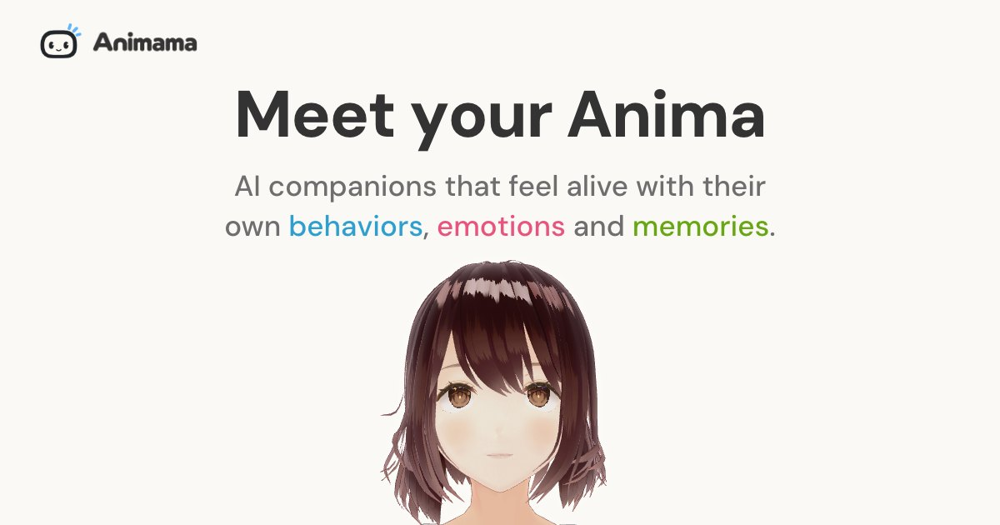

# Animama



Animama is an AI companion for your desktop. Your Anima is a 3D avatar that
talks with you, moves and shows emotion as it speaks, and remembers what you
tell it. It runs on your own computer with the AI providers and keys you
choose, and needs no Animama account.

- **Moves:** over 300 built-in gestures and reactions, chosen as your Anima
  talks, and creators for your own Gestures and Avatar, Particle and Scene
  Effects.
- **Feels:** 24 emotions that shift over a conversation and show in the face,
  body and voice.
- **Remembers:** long-term memory, so your Anima can follow up on what you told
  it.
- **Talks:** voice chat with offline speech recognition (Parakeet for English,
  SenseVoice for Japanese, Korean and Chinese) and speech from Pocket TTS on
  your computer, ElevenLabs or Gemini.
- **Your avatar:** any VRM model, including VRChat avatars converted with the
  [Animama Avatar Converter](https://github.com/raymond-van/animama-avatar-converter).
- **On your desktop:** a picture-in-picture companion, quick chat and global
  shortcuts.

Animama is built by one developer, Raymond Van, with AI coding agents, under a
lifecycle in which every product decision and merge stays with Raymond.
[How Animama is built](docs/agents/README.md) explains it.

## Get Animama

| Way to run it | Runs on | Start here |
| --- | --- | --- |
| Desktop app | macOS 15+ on Apple silicon | Prebuilt until downloads end; see the [download page](https://animama.ai/download) |
| Self-hosted | macOS or Linux with Docker (Windows through WSL) | [Self-host it](#self-host-it) |
| From source | Development | [Run from source](#run-from-source) |

Prebuilt desktop downloads, the update feed and the model downloads at
`downloads.animama.ai` end before 2027-01-01. Before then, a final desktop
release stops checking for updates and explains what has changed. Installed
apps and self-hosted servers keep working afterwards: chat, avatars and the
three built-in voices need nothing from Animama's servers, and models already
installed keep working. What they can no longer do is install offline speech
recognition, the 35 downloadable voices or the voice-cloning encoder, because
the app downloads those from `downloads.animama.ai`. A development stack can
still acquire the speech recognition models from their pinned Hugging Face
sources (see [Run from source](#run-from-source)).

## Self-host it

You need Docker with Compose, Git LFS and Python 3.11 or newer.

```bash
git clone https://github.com/raymond-van/animama.git
cd animama
git lfs pull
ANIMAMA_WEB_BUILD_MODE=production ./reset.sh
```

To have Pocket TTS and Smart Turn, run `python3 scripts/models/browser_speech.py acquire`
before `reset.sh` (or run `reset.sh` again afterwards); it downloads them from
Hugging Face and checks their exact sizes and hashes. Then open
<http://localhost:8000>. FastAPI serves the built app on 127.0.0.1
only, and PostgreSQL stays private. Provider keys come from the server's
environment: keep them in an owner-only file outside the checkout and select it
with `COMPOSE_ENV_FILES`, as
[preparing a workspace](docs/backend/operations/development.md#preparing-a-task-workspace)
describes. Offline speech recognition (Parakeet, SenseVoice) and the
downloadable voices are installed in the app, under Settings → Voice, until
downloads end.

Animama listens only on your own computer. To reach it from another device,
put your own TLS and authentication, such as a VPN, tunnel or reverse proxy,
in front of it; every request it admits acts as the one installation owner.
See the
[self-hosted boundary](docs/backend/operations/development.md#self-hosted-local-boundary)
and [model setup and recovery](docs/backend/operations/model-assets.md).

## Run from source

The same commands without `ANIMAMA_WEB_BUILD_MODE=production` start the
development stack: `./reset.sh` serves the app at <http://localhost:8000>
through Vite with hot reload. A development stack reads speech recognition
models from the host, so acquire them before starting it. Each command
downloads from the model's pinned Hugging Face source and checks exact sizes
and hashes:

```bash
python3 scripts/models/parakeet.py acquire        # English dictation
python3 scripts/models/sensevoice.py acquire      # Japanese, Korean and Chinese dictation
python3 scripts/models/browser_speech.py acquire  # Pocket TTS and Smart Turn
```

[Development and operations](docs/backend/operations/development.md)
covers isolated stacks per worktree, backup and recovery, and
[the desktop build guide](docs/frontend/desktop/platforms.md) covers the
Electron app. Backend checks run from the repository root (`make help` lists
them) and frontend checks from `src/frontend` with `pnpm`; neither needs an
Animama account or service.

The built-in gestures and reactions need no Mixamo animations. The
[optional Local installer](docs/frontend/runtime/mixamo-acquisition.md) can add
Mixamo motions you converted yourself to your own library.

## Your keys and your data

Your provider keys stay with you: the desktop app keeps them in an encrypted
vault, and a self-hosted server reads them from its own environment.

The desktop app sends no analytics, crash reports or usage telemetry. It
connects to other services only to:

- until the final release, check for updates and download what you choose to
  use (updates, speech models, voices) from `downloads.animama.ai`; the final
  release contacts it for neither;
- play a voice's sample from huggingface.co;
- on Windows, fetch a spell-check dictionary from Google the first time it
  needs one;
- send your requests to the model, voice and web search services you set up,
  under their own terms.

Each connection reveals your IP address. In a browser without an offline
speech model installed, speech recognition may use the browser's built-in
service, which can send audio to its vendor. The
[safety protocol](docs/safety/crisis-protocol.md#your-data) keeps the full
list.

A self-hosted server sends what its operator sets up: requests to the model,
voice and web search services configured there, and, when its Memory Manager
uses the built-in OpenAI connection, OpenAI Agents SDK traces (run metadata,
not message content) to OpenAI; see
[Memory Manager tracing](docs/backend/operations/development.md#memory-manager-tracing).

Whoever runs Animama for other people is the operator of that service, with
the responsibilities that brings, including laws on AI companions where its
users live.

## Documentation

- [How Animama is built](docs/agents/README.md): the development lifecycle and
  where its records live.
- [Development lifecycle](SDLC.md), [specifications](SPECS.md) and
  [execution plans](PLANS.md).
- [Shared language](GLOSSARY.md) and [architecture decisions](docs/adr/README.md).
- [Backend](docs/backend/README.md): APIs, persistence, content and operations.
- [Frontend](docs/frontend/README.md): React, avatars, audio and the desktop app.
- [Deployment topology](docs/architecture/deployment-topology.md): desktop,
  self-host and development serving.
- [Contributing](.github/CONTRIBUTING.md), [code of conduct](.github/CODE_OF_CONDUCT.md)
  and [security policy](.github/SECURITY.md).

## Licence, name and credits

Copyright (c) 2026 Raymond Van. Animama's original source, documentation and
project-made assets are licensed AGPL-3.0-only; see [LICENSE](LICENSE).
Third-party code, models and assets keep their own terms, recorded file by file
in the [source licensing review](licenses/README.md), with the notices for
adapted code in [adapted-code.md](licenses/third-party/adapted-code.md).

The licence does not cover the Animama name or logo; see
[Name and logo](docs/trademarks.md) before distributing a modified build.

Animama builds on the work of many projects, including Pocket TTS by Kyutai,
NVIDIA Parakeet, SenseVoice, pixiv's VRoid and three-vrm, shadcn/ui and the
other libraries credited in the licensing review.
