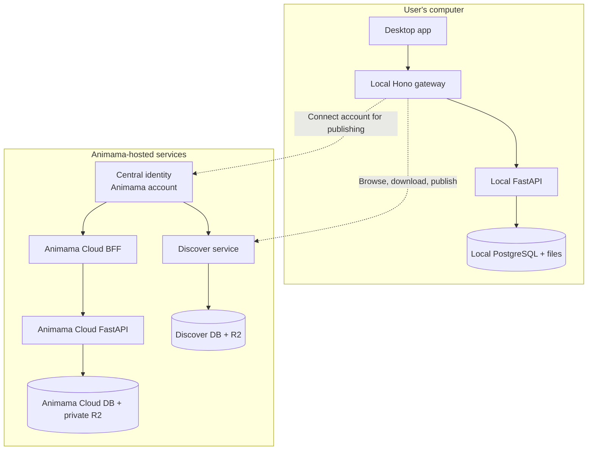

# Animama deployment topology

Repository ownership: this high-level logical diagram stays in the public/local
repository. It describes optional service relationships without requiring
private source, execution plans or operator runbooks. See
[Repository boundaries](repository-boundaries.md) and
[Discover contract ownership](discover-contract-ownership.md).

This diagram records the logical boundary between the local product and
Animama-hosted services. **Animama Cloud** initially offers a deliberately
limited free tier; that tier is policy within the hosted product, not a separate
demo application. Logical services may initially share a VPS or managed
PostgreSQL cluster, but they keep separate application, trust, data, migration,
and credential boundaries.

Durable architecture and operating references:

- [Repository boundaries](repository-boundaries.md): source, implementation and
  planning ownership.
- [Discover public contract ownership](discover-contract-ownership.md): proposed
  optional service contracts and compatibility evidence.
- [Local backend architecture](../../src/backend/docs/architecture/overview.md)
  and [local operations](../../src/backend/docs/operations/development.md):
  accountless startup, gateway, persistence and development composition.
- [Desktop overview](../../src/frontend/docs/desktop/overview.md) and
  [desktop operations](../../src/backend/docs/operations/desktop-runtime.md):
  the embedded local runtime and recovery boundary.

Full execution plans and hosted operational procedures are privately retained.
Their location does not make private access a requirement for the local product.
