# Animama deployment topology

The local product builds and runs independently of hosted services. Desktop is
the primary product; single-owner self-hosting is also supported. Hosted work
is deferred while the local runtime and source-release preparation are completed.
Discover and local-hosted account connection are discontinued.

```mermaid
flowchart TB
    subgraph Desktop["Self-contained desktop"]
        Electron["Electron supervisor and windows"]
        LocalAPI["FastAPI: React build, APIs and permitted bytes"]
        LocalData[("Installation PostgreSQL and files")]
        Electron --> LocalAPI --> LocalData
    end
    subgraph SelfHost["One self-host installation"]
        Browser["Browser"]
        App["FastAPI: React build and APIs"]
        Data[("Private PostgreSQL and files")]
        Browser --> App --> Data
    end
    subgraph Development["Compose development"]
        DevBrowser["Browser or external-stack Electron"]
        Vite["Vite: React development and HMR"]
        DevAPI["Private FastAPI"]
        DevData[("Isolated PostgreSQL and files")]
        DevBrowser --> Vite --> DevAPI --> DevData
    end
```

Only the selected application service publishes a loopback port: FastAPI for
built self-hosting, Vite for development. The default is `localhost:3000`.
Electron's embedded FastAPI uses the saved installation origin. PostgreSQL and
workers are private; optional local administration tools use separate loopback
ports. FastAPI authorizes API and byte requests in every local composition.
Remote access requires an operator-owned authentication and TLS boundary.

The eventual hosted product is intended to retain saved companions and chats
within a limited free tier. Its deployment, account/session boundary, databases,
credentials and migration ownership are separate from this local installation.
Cloudflare and a VPS are planned infrastructure; this document does not declare
those services deployed or require private code for local builds.

Durable references:

- [Repository boundaries](repository-boundaries.md): source and implementation ownership.
- [Local HTTP boundary](../../src/frontend/docs/architecture/auth-server.md): serving, admission and recovery.
- [Local backend architecture](../../src/backend/docs/architecture/overview.md) and
  [local operations](../../src/backend/docs/operations/development.md).
- [Desktop overview](../../src/frontend/docs/desktop/overview.md) and
  [desktop operations](../../src/backend/docs/operations/desktop-runtime.md).

Execution plans and hosted operator procedures remain private. They are not
local build, runtime or contributor prerequisites.
