# Animama deployment topology

Animama supports a self-contained desktop application and single-owner
self-hosting. Both run independently of hosted services.

```mermaid
flowchart TB
    subgraph Desktop["Self-contained desktop"]
        Electron["Electron supervisor and windows"]
        LocalAPI["FastAPI: React build, APIs and permitted bytes"]
        LocalData[("Installation PostgreSQL and files")]
        Electron --> LocalAPI --> LocalData
    end
    subgraph SelfHost["One self-host installation"]
        Browser["Browser"]
        App["FastAPI: React build and APIs"]
        Data[("Private PostgreSQL and files")]
        Browser --> App --> Data
    end
    subgraph Development["Compose development"]
        DevBrowser["Browser or external-stack Electron"]
        Vite["Vite: React development and HMR"]
        DevAPI["Private FastAPI"]
        DevData[("Isolated PostgreSQL and files")]
        DevBrowser --> Vite --> DevAPI --> DevData
    end
```

Only the selected application service publishes a loopback port: FastAPI for
built self-hosting, Vite for development. The default is `localhost:8000`.
Electron's embedded FastAPI uses the saved installation origin. PostgreSQL and
workers are private; optional local administration tools use separate loopback
ports. FastAPI authorizes API and byte requests in every local composition.
Remote access requires an operator-owned authentication and TLS boundary.

Durable references:

- [Repository boundaries](repository-boundaries.md): source and implementation ownership.
- [Local HTTP boundary](../frontend/architecture/auth-server.md): serving, admission and recovery.
- [Local backend architecture](../backend/architecture/overview.md) and
  [local operations](../backend/operations/development.md).
- [Desktop overview](../frontend/desktop/overview.md) and
  [desktop operations](../backend/operations/desktop-runtime.md).
