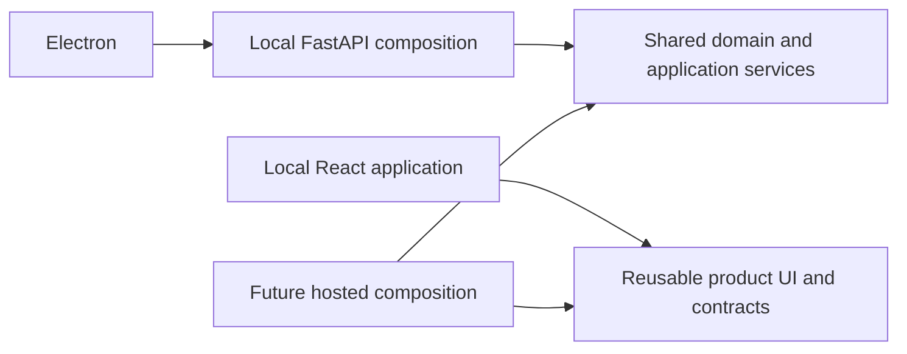

# Repository boundaries

Animama owns the local desktop and self-host application, reusable product code,
public artifact contracts, tests and contributor documentation. It builds and
runs without a private Cloud checkout, hosted credentials or private plans.
The working source remains proprietary; “public” in classification metadata
means the intended source destination, not permission to publish a file.

## Code and data ownership



Shared Python domain/application code accepts explicit owners, ports, policies
and units of work. It must not import the local or HTTP composition, configure
logging, read installation state or initialize databases. The local app factory
owns those effects, installs the request-principal resolver and authorizes
requests before resolving the generated installation owner.

The local Alembic graph owns the accountless installation schema. Existing
`user_id` columns remain installation ownership columns. A future hosted
composition must provide separate identity resolution, migrations, bootstrap,
storage and tenant policy. It must not read the local installation tables or
choose an owner from client headers. Hosted work is deferred; central identity
code retained privately is not a local dependency or deployed prerequisite.

Frontend product features accept an injected transport and owner context. Local
routes, readiness, provider configuration, voice/avatar adapters and Electron
integration stay in the local application. Package source cannot import
`web`, `desktop`, private aliases or a sibling checkout.

## Stable artifact boundary

| Artifact | Responsibility |
| --- | --- |
| Python wheel | Reusable backend domain/application contracts and supported provider adapters. |
| `@animama/runtime-contracts` | Runtime owner, transport and capabilities; generated API types, SDK and validators. |
| `@animama/product-ui` | Injected product providers, Anima selection, chat session/stream behavior, transcript and composer. |
| `@animama/discover-client` | Inert compatibility package retained in the artifact set. Discover and local account connection are discontinued. |

Private consumers pin immutable commits and packed wheel/npm/contract identities.
Public builds do not read the private lock or require its checkout. The current
package set and wire contracts remain stable through local cleanup; see
[contracts](../../contracts/README.md) and
[artifact tooling](../../scripts/package-sets/README.md).

Boundary checks build and install artifacts outside the checkout. They exercise
shared services and browser consumers with explicit fake owners and transports.
These tests establish portability; they do not establish hosted deployment,
physical audio, native release acceptance or publication rights.

## Contributor documentation

- [Backend](../backend/README.md): APIs, content, persistence and operations.
- [Frontend](../frontend/README.md): browser and desktop implementation.
- [Deployment topology](deployment-topology.md): supported serving arrangements.
- [Discover compatibility](discover-contract-ownership.md): retained inert surface.

Full execution plans, split history, private backlog and owner approval records
are retained privately. They are not local build or contributor prerequisites.
The export tooling verifies exact committed inputs and generates split receipts
in candidate directories. The active checkout does not require a root split receipt.

## Classification, provenance and licensing

[repository-boundary.toml](../../repository-boundary.toml) is an active local
check input. Its explicit path groups give every tracked file one owner and
require a decision for new files. Keep this metadata synchronized with moves
and additions; do not substitute a catch-all public glob.

[repository-provenance.json](repository-provenance.json) records source blobs,
hydrated payload hashes, LFS identities, evidence references and publication
status for covered third-party, adapted and asset inputs. Exported-snapshot
history and reviewed local amendments retain earlier evidence. A move changes
its current path, not its rights disposition. Preserve third-party licenses,
notices and required source attribution.

Classification, secret scans, license detection and successful builds do not
grant redistribution permission. Pending and blocked publication records must
be resolved before preparing an accepted public candidate. Raw-asset permission
and embedded-product distribution permission are distinct. Required starter
content must retain its behavior through verified permission or an explicitly
approved equivalent replacement.

The working repository retains its proprietary [LICENSE](../../LICENSE). The
planned public release uses AGPL-3.0-only for project-owned material, with
third-party terms preserved. The choice to preserve Git history or publish a
clean snapshot is deferred until final source review. The current repository
and history remain private and intact. Outside contributions are initially
deferred; the proposed license does not grant rights to the current tree.

## Verification

From the repository root:

```bash
uv run --no-sync python scripts/repository-boundary/check-python-imports.py
uv run --no-sync python -m unittest discover -s scripts/repository-boundary -p 'test_*.py'
git ls-files -z | uv run --no-sync python scripts/repository-boundary/audit-classification.py --stdin --check
git diff --check
```

Use the [boundary-tool guide](../../scripts/repository-boundary/README.md) for
provenance checks, independent consumers and a disposable index when checking
unstaged additions. Never include ignored runtime state merely to satisfy an
inventory. Preserve databases, Local content, vaults, installed packs and backups
when relocating or cleaning source. Publication and release uploads require
their own exact-candidate review and explicit authorization.
