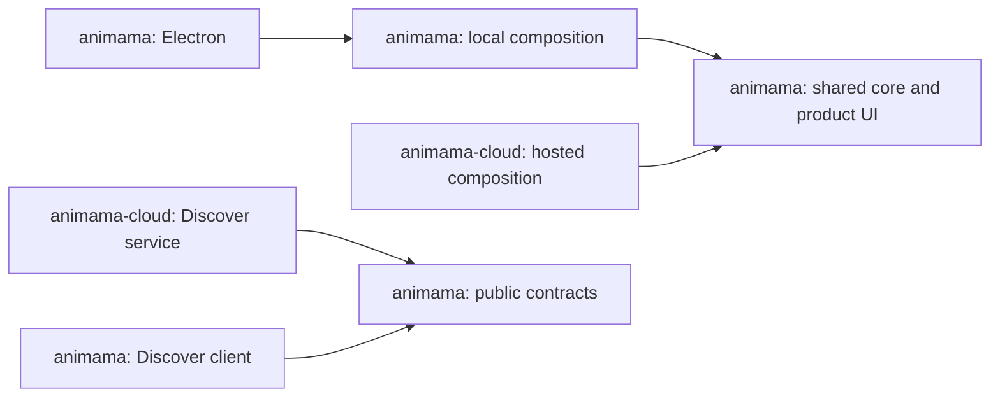

# Animama repository boundaries

The ownership contract was verified by the user on 2026-09-08 with the
planning-document amendment below. The shared import and package boundaries
described here are implemented and were verified by the user on 2026-09-08.
This durable reference stays in `animama` and grants no publication approval.
Full execution plans and generic `PLANS.md` guidance
are private planning records; public builds and contributor workflows must not
require those files.

## Repositories and dependency direction

The two new source repositories are `raymond-van/animama` and
`raymond-van/animama-cloud`. Both are private. Their technical cutover is
complete, owner verification is recorded on 2026-09-08, and the source freeze is
lifted. These are the active source repositories. The existing
`raymond-van/animama-releases` remains the binary installer/update/feature-pack
repository with its own release approvals.

Cloud consumes an immutable public-repository commit plus wheel, npm and
contract artifact identities/hashes in its own `upstream/animama.lock`. No
public/local build imports private source, requires the private checkout, or
reads a private service database. A local client may use a documented hosted
HTTP contract. Artifact-based sibling development is checked against that lock;
it is not the normal dependency format and introduces no submodule.

## Source ownership

The exact file list is [repository-boundary.toml](../../repository-boundary.toml).
Its groups use explicit paths rather than a default-public glob: a newly tracked
file requires a classification decision. Each path has exactly one owner.

| Area | Owner | Boundary |
| --- | --- | --- |
| Backend domain, use cases, chat/model-client contracts and ports | `public` | Shared owner-scoped product behavior, with transitive imports checked independently of local composition. |
| Backend server, local adapters/ORM/workers, frozen runtime and packaging | `public` | Local composition and public provider integrations. Cloud receives reusable interfaces, not a copied local app factory. |
| Local Alembic graph and seeds, Compose/reset/backup tooling | `public` | Accountless installation persistence and local/self-host operations. |
| React product features, local routes and generated SDK/router | `public` | Reusable Anima/chat surface in `product-ui`; SDK in `runtime-contracts`; local routes and generated router remain in `web`. |
| Local HTTP boundary and Electron | `public` | Explicit local trust and desktop runtime. No central Better Auth implementation. |
| Local observability, `tests/loadtest`, developer configuration and release tooling | `public` | Existing local product development/distribution inputs; secrets are supplied externally. Imported material retains separate provenance review. |
| Durable architecture, public contracts and operational documentation | `public` | Includes the logical deployment topology and Discover client contracts; public readers do not need private execution plans. |
| All full ExecPlans under `**/plans/**` and generic `PLANS.md` | `cloud` | Includes local, desktop, client, identity, hosted, service and split plans. Document location does not change where their implementation belongs. |
| Existing explicitly excluded development media and maintainer scratch strategy | `archive` | Private historical recovery only; no active repository export. Classification removes no current file. |
| Tracked assets, models, fonts, notices, adapted skills and vendored source | Per file | Source destination and publication status are independent; see provenance below. |
| Build/cache outputs | `excluded-generated` when present | Only proven disposable output qualifies. No current tracked file needs this disposition; SDKs, router output and `desktop/build` are retained build inputs. |

The former `cloud/` application was deleted by the approved Phase 0 retirement.
It is absent from the current inventory and must not be resurrected during
export. Root `TODO` is private maintainer strategy, including superseded naming
ideas; `TODO2.md` remains the current local bug/journey backlog.

Public target shape:

    animama/
      src/backend/animama/{domain,app,adapters,orm,local,server,workers,runtime}/
      src/frontend/packages/{runtime-contracts,product-ui,discover-client}/
      src/frontend/{web,server,desktop,shared}/
      contracts/
      content/                         reviewed local runtime inputs
      deploy/self-host/                when introduced
      docs/                           durable architecture, contracts and operations
      tests/

Private target shape:

    animama-cloud/
      services/{identity,discover-api,hosted-api,workers}/
      apps/{account-web,hosted-bff,hosted-web,discover-web}/
      packages/{cloud-contract-adapters,policy}/
      deploy/
      infra/
      docs/plans/                     full root ExecPlans, including local/client plans
      src/{backend,frontend}/docs/plans/  preserved nested planning paths
      PLANS.md                        private planning guidance
      tests/
      upstream/animama.lock

Planning paths are preserved relative to the source unless the manifest records
an explicit collision-safe mapping. Export no public stub ExecPlans. Public
indexes and contributor guidance use durable architecture, contracts and
operations; retained documentation no longer depends on private planning files.
These source boundaries do not imply that private product services have been
built. Public packages and the bounded Anima/chat consumer live in `animama`.
Cloud contains a health-only foundation and consumes the packed public
artifacts; authentication, Discover and hosted product behavior remain
unimplemented. All full plans have migrated to private Cloud, including plans
for local code; public guides are sufficient without access to those records.

## Executable shared boundary

Shared Python domain/application modules receive owner IDs, ports, policies and
units of work. The transitive import checker follows their helpers and package
initializers, rejecting local/server composition and private service imports.
`animama.local` owns installation persistence, the installation principal,
browser request admission and database construction. The local app factory
injects its database session factory and lifecycle providers. Product schemas
live in `animama.app.contracts`, and neutral logging imports do not configure
the local application. Packaged animation/VFX catalogs are verified against
their canonical frontend JSON inputs at wheel build time.

The frontend has three independently packed packages:

| Package | Public surface and ownership |
| --- | --- |
| `@animama/runtime-contracts` | Opaque runtime owner, capabilities, lifecycle summaries and `ProductApiTransport`; generated SDK, API types and validators through explicit exports. |
| `@animama/product-ui` | Injected runtime provider, owner-scoped queries and chat session/SSE behavior, Anima selection, transcript and composer, plus emitted CSS. |
| `@animama/discover-client` | Proposed client-visible schemas, request construction and inert fixtures. The protocol remains unratified; this package implements no identity or Discover service. |

Local React composes these same product surfaces with local routes,
personalization, voice/avatar effects and desktop settings. SDK calls use the
injected transport. Thumbnail URLs come from runtime content and use that
transport; consumers do not need the local web asset tree. The package builder
rejects imports outside package source and emitted declarations using the web
application's private alias. Compose builds packages before starting Vite;
only the selected application service publishes a loopback port: Vite in
development, FastAPI with baked React assets in built mode.

The [boundary tools](../../scripts/repository-boundary/README.md#shared-import-and-artifact-checks)
build and validate a Python wheel and all three npm tarballs. An isolated
consumer installs those artifacts outside the checkout, checks declarations,
builds React, exercises Anima selection and chat streams under two independent
fake owners, and verifies CSS, images, cancellation and stale-event handling.
A separate wheel consumer exercises actual shared services with injected fake
ports while blocking local imports. These checks do not implement a hosted
composition or replace local setup, persistence and native acceptance checks.

## Local split rehearsal

`scripts/repository-boundary/export.py` reads an exact committed tree and the
ownership manifest from that same revision. The manifest's exact mappings place
private health-only workspace inputs in their cloud destinations. Unmapped
active paths retain their relative locations. Archive and generated exclusions
are recorded without copying their bytes. Output directories must be empty;
unsafe paths, case collisions, symlinks, secret canaries and missing or altered
LFS objects fail before a candidate can be accepted. LFS payloads come from the
verified local object store, not from uncommitted working-tree files.

The export manifest binds every source blob and destination payload. Each
candidate also receives `SPLIT_PROVENANCE.md` with source and mapping identities,
without the old remote URL. Public ownership and asset provenance are projected
to public paths only. Their explicit `exported-snapshot` mode validates the new
repository's index, evidence hashes and materialized LFS objects without needing
the private monorepo's history. It does not grant publication rights.

The public candidate gets a fresh `main` root commit before its wheel and npm
packages are built. Cloud's `scripts/pin-upstream.py` binds that exact public
revision to the four packed artifacts and contract declarations. Bootstrap
artifacts, dependency locks and `upstream/animama.lock` form a separately hashed
generated layer over the cloud source export. The verifier checks every layer
addition/replacement against its declared base; a changed local artifact or
mutable revision cannot silently pass.

Run exact export verification before installing dependencies or starting a
stack. Keep a second untouched export for repeatability and snapshot scanners;
build outputs and local runtime state are never export inputs. The private cloud
workspace contains health-only entrypoints and bounded artifact consumers. It
implements no identity, Discover or hosted product behavior. Local rehearsal
does not authorize remote creation, push, source publication or history rewrite.

## Service, data and migration ownership

| Composition/service | Identity and owned data | Migration authority |
| --- | --- | --- |
| Local installation | Generated installation principal; local profile, Animas, chats, memory and Included/Local catalog | Public local Alembic graph and bootstrap; Electron uses the same local resources. |
| Central identity | Better Auth `user`, sessions and account lifecycle; one-to-one product `user_profiles` | Private identity migrations and supported identity contracts. |
| Hosted product | Verified Better Auth `user.id` directly owns durable private product rows/objects; plan membership selects commercial policy | Private hosted migration graph, resolver, app factory, bootstrap and tenant adapters. |
| Discover | Publications, immutable versions, creator authorization and delivery state, keyed by verified central user ID | Private Discover migration graph and service authority. |

Shared services receive owners, ports and policies explicitly. They do not
select local or hosted security by an environment mode. Local installation IDs,
central user IDs, plan memberships and publication/version IDs are distinct
concepts. Plan upgrades preserve the hosted user's ID and durable data.

Full plans for local and desktop work remain private for planning purposes;
their source code, shared APIs and durable documentation still belong to
`animama`. No Cloud source or private planning document is a local build or
runtime prerequisite.

One Git repository or physical database cluster does not grant a service access
to another service's tables, migrations, role or credentials. A deployment unit
does not require a separate Git repository. Hosted ingress, service placement
and operator configuration are private composition decisions.

Hosted Animama starts with a limited `free` plan. Limits, admission, retention
and provider budgets are versioned policy, not app-factory or database names.
There is no assumed disposable session, routine destructive reset or new owner
ID on a paid upgrade. Exact retention/quota/deletion policy remains under the
hosted and identity plans' own verification gates. An account is optional for
local use; connecting to Discover does not replace the installation owner or
grant publication authority merely because content exists locally.

## Provenance and current licensing posture

[repository-provenance.json](repository-provenance.json) records each required
path, Git blob, hydrated payload SHA-256, LFS object identity/size where
applicable, evidence references and publication status. Its evidence groups
reuse the existing [Included content inventory](../../content/included/licenses/inventory.json),
[desktop license sources](../../src/frontend/desktop/runtime/license-sources.json),
adjacent notices and adapted-source attribution. Missing notices and unclear
origins are recorded as gaps, not replaced by the root copyright notice.

Coverage includes all Included content and public runtime files, models,
vendored/adapted source and examples, media/fonts, imported observability
material, and every Git LFS path. LFS also contains JavaScript and documentation;
neither file extension nor parent directory establishes redistribution rights.

`public` means the intended `animama` destination. It does not mean open source,
redistributable, scanner-cleared or approved for publication. Existing embedded
desktop distribution decisions do not establish permission to publish standalone
source assets. Specifically:

- Existing explicit exclusions for downloaded voices/music/backgrounds and
  unapproved avatars/derived metadata are assigned `archive`. The private split
  rehearsal audited the retained catalog and exercised the isolated local
  application without those inputs. Recorded backend test limitations remain;
  this is not a claim that every starter-materialization test passed. Future
  changes must preserve that independence; fix
  retained references in reviewed source before regenerating candidates.
- Mixamo-derived animation inputs retain their recorded embedded-product
  limitation and block raw publication pending a separate disposition. Their
  existing private runtime remains unchanged. A private candidate is not a
  license grant; resolve source delivery by permission, replacement/removal or
  continued private status before publication.
- Models and adapted/vendor code retain their own terms and unresolved
  source/notice reviews. Historical fallback attribution remains explicitly
  unknown. A detected license or payload match alone is not final clearance.

Animama-authored source currently uses the root proprietary [LICENSE](../../LICENSE),
Python `LicenseRef-Proprietary` with `LICENSE` in distributions, and
`UNLICENSED` on private JavaScript packages. These current declarations were
checked; they do not settle historical MIT declarations or third-party grants.
The eventual source license and external contribution policy are **UNDECIDED**.
Existing private owner-led development continues. No CLA/DCO, external rights
assignment or open-source license is introduced by Phase 1. A future policy
must be explicitly selected before soliciting public contributions.

[Scanner pins](../../scripts/repository-boundary/scanner-pins.json) record exact
Gitleaks and ScanCode versions, official release digests, command shapes and
verification limits. The private split rehearsal ran pinned Gitleaks file and
history scans and Linux/Python 3.12 ScanCode checks, with findings reviewed
against the exact export inventory. One raw model license-scan timeout remains
an explicit adjudicated limitation, supported by complete byte accounting and
separate text-field scanning; this is not a wholly green raw license scan.
The later source-publication audit must refresh coverage, resolve rights and
perform the planned history/REUSE review. These scans do not authorize public
visibility or clear pending asset rights. Raw findings, removal recipes,
credentials and backup material remain outside public Git and release assets.

## Cutover status and recovery policy

The owner approved the private source cutover on 2026-09-08 after deterministic
exports, independent candidate validation and private Git/LFS recovery checks.
The old monorepo is preserved under the approved private name
`raymond-van/animama-legacy` and the local preservation path
`/Users/ray/code/animama-legacy`. The new working checkouts are fresh clones at
`/Users/ray/code/animama` and `/Users/ray/code/animama-cloud`, each with its own
Git root. The local root move and linked-worktree repair are complete. The
runtime snapshot and database backup are durably retained privately. Both
initial-root GitHub CI workflows, public staging integrity and final-path clone
checks passed. Runtime transfer, restart and continuity checks passed, including
the preserved reference stack. All 11 important database tables match the
pre-cutover state; the catalog's 24 unavailable items are exactly accounted for
by the 29 intentionally archived source files, with no unexpected missing items
or deletion. The local application at http://localhost:3000 passes the focused
avatar/navigation/composer smoke. Native/audio/voice acceptance was not repeated.
The legacy remote is private and archived with Actions disabled. Technical
cutover is complete and owner-verified on 2026-09-08; the source freeze is lifted.
Both new checkouts are the active sources of truth. Initial commits and tags
stay immutable; later documentation changes are recorded separately.

Enforced default-branch protection has an explicit owner-approved exception
until the owner says otherwise. There is no automatic expiry, recurring
approval or Pro prerequisite. Both source repositories remain private; reviewed
changes and CI remain the development workflow, without claiming branch rules
are technically enforced. Actions use read-only default workflow tokens and
cannot approve pull requests automatically. Optional secret scanning and push
protection were not enabled by this cutover; no paid entitlement or public
fallback is assumed.

Keep the complete old Git history and separately verified LFS payloads private.
A Git bundle does not contain LFS or ignored local runtime data. Preserve
configuration, local content/data/runtime directories and Compose volumes when moving a checkout. Never transplant the old `.git`
directory, purge runtime data, or pair an existing database with an empty new
content directory. Repair linked worktree references and keep active processes
associated with the correct checkout. Initial candidates remain immutable;
later corrections belong in separately reviewed commits.

The binary `animama-releases` repository, release/pack URLs,
`com.animama.desktop`, signing identities and reviewed release receipts remain
unchanged. Source cutover grants no release dispatch or publication approval.
Cloud product implementation remains subject to its own implementation gates;
the health-only foundation does not implement identity, Discover or hosted use.

## Historical classification checkpoints

The source inventory began at `fdada45a`. Concurrent separately committed work
removed four mockup PNGs (`6bd95998`), updated the split plan (`b276046c`),
standardized local log paths (`66ccb27e`), relocated Locust files into
`tests/loadtest` (`1ebef48d`), consolidated local migrations (`09ead088`) and
consolidated database bootstrap resources (`ac36a3c6`).
Phase 1 preserves those changes and classifies their final paths; their runtime
validation remains owned by their respective changes. The final baseline is
`ac36a3c6` plus Phase 1 commit `b331c485`. The
split-plan conflict from concurrent work was resolved while preserving cleanup
evidence and the current handoff.

The committed Phase 2 inventory uses `b331c485` as its reviewed
baseline: 2,913 paths in 24 groups, comprising 2,820 `public`, 63 `cloud`,
30 `archive` and zero `excluded-generated`. The historical Phase 1 counts below
describe its committed snapshot. All 62 full ExecPlans and `PLANS.md` were
private at that checkpoint. Provenance coverage and publication decisions are unchanged: 860
records, 368 LFS paths / 263 objects, 760 pending, 100 blocked, zero approved.

The Phase 3 source inventory uses the user-verified Phase 2 commit `77e8b239`
as its provenance baseline: 2,985 paths in 25 groups, with 2,828 `public`, 127
`cloud` and 30 `archive`. Cloud owns all 62 planning files and 65 workspace/
pinning inputs. The exported public inventory is a projection of this source
record and includes its generated `SPLIT_PROVENANCE.md`; counts in an exported
checkout therefore describe its own complete file set.

## Verification and review

Run from the repository root with Python 3.11 or newer through the project
environment; macOS's system `python3` may be older:

    uv run --no-sync python -m unittest discover -s scripts/repository-boundary -p 'test_*.py'
    git ls-files -z | uv run --no-sync python scripts/repository-boundary/audit-classification.py --stdin --check
    git lfs ls-files
    git diff --check

Before new files are staged, use the documented disposable-index workflow in
the [checker README](../../scripts/repository-boundary/README.md). It must not
modify the real index. Check the exact prospective tracked set, not all files
under ignored runtime/data/cache directories. An ownership pass means complete
classification and matching provenance evidence; pending publication statuses
remain pending. The exporter enforces destination safety separately.

Recorded Phase 1 validation (2026-09-08):

| Check | Result |
| --- | --- |
| Complete prospective tracked inventory | 2,814 paths: 2,721 `public`, 63 `cloud` (62 full ExecPlans plus PLANS.md), 30 `archive`, zero `excluded-generated`; 21 explained groups. |
| Provenance and materialized LFS | 860 records, 62 evidence groups, all 368 LFS paths / 263 distinct objects reconciled. 760 publication reviews pending, 100 blocked, zero approved. |
| Classifier and builder tests | 25 passed, including real temporary Git repositories, unknown provenance, drift, LFS hydration, new paths, private planning enforcement and read-only checking. |
| Existing documentation-generator tests | 12 passed. |
| Scoped Ruff and whitespace | Passed for new tools and the Phase 1 diff. |
| Deterministic provenance | Rebuilt comparison passed against the reviewed source and supporting evidence. |
| Relative Markdown links | No new missing target across the prospective tracked Markdown set. Nine existing mockup-image links remain from prior work. |
| Scanner preparation | Official release digests recorded; downloaded native Gitleaks hash/version and synthetic detection canary passed. Full candidate/history scans and ScanCode execution remain Phase 3 work. |

The complete audit used a disposable index and private object directory; the
real Git index hash remained unchanged. Initial integrated evidence and the
final refreshed run are retained in the private Phase 1 audit archive. The
passing current audit is distinct from the
future clean-commit Phase 3 export. Full application, browser/audio/native and
cloud integration suites were not run for this documentation/inventory change.

The user verified the ownership/archive choices, provenance gaps, continued
private/undecided licensing posture, contribution-policy deferral and cutover
proposal, subject to assigning all full plans and `PLANS.md` privately. That
amendment is implemented, validated and committed. Phase 1 is complete; the
Phase 2 implementation is user-verified. Later phase
gates and the separate final source-publication decision remain intact.

## Public documentation handoff at export

Backend architecture and feature references, frontend feature and desktop
guides, both documentation indexes and the root agent guide use durable public
references. Desktop release acceptance gates and creator UX/review status remain
explicit in those guides. Desktop size checks read the versioned
`src/frontend/desktop/runtime/size-approvals.json` ledger; their operation does
not require a private ExecPlan. The ledger starts empty and grants no exception.

The public CI workflow runs portable ownership, package, frontend and desktop
checks without cloud credentials. Required compatibility asset mounts point to
retained inputs; five obsolete mounts backed by retired development asset trees
were removed after the independent build exposed them. A root test package
marker prevents installed dependencies from shadowing local test helpers in a
fresh Python environment. Neither fix restores archived assets or changes
release acceptance requirements.

Portable regression fixtures exercise audio parsing and pack exclusions with
generated samples. Catalog checks cover the committed content set and validate
optional content when present, without requiring private development examples.

## Package-set development workflow

The [public package producer](../../scripts/package-sets/README.md) builds and
validates exact-commit wheel/npm/schema sets without private source or storage
credentials. GitHub Actions retains temporary PR/main outputs and test evidence.
Private maintainers select validated content-addressed sets for a dedicated
private package bucket; that storage is independent of ordinary public builds
and of the desktop distribution repository. Cross-repository workflow and
storage approval records remain private. The publication boundary and
source-license gates above are unchanged.

Shared/local bug reports belong here; sensitive hosted/abuse/customer details
belong in a private channel. See [the security policy](../../SECURITY.md).
