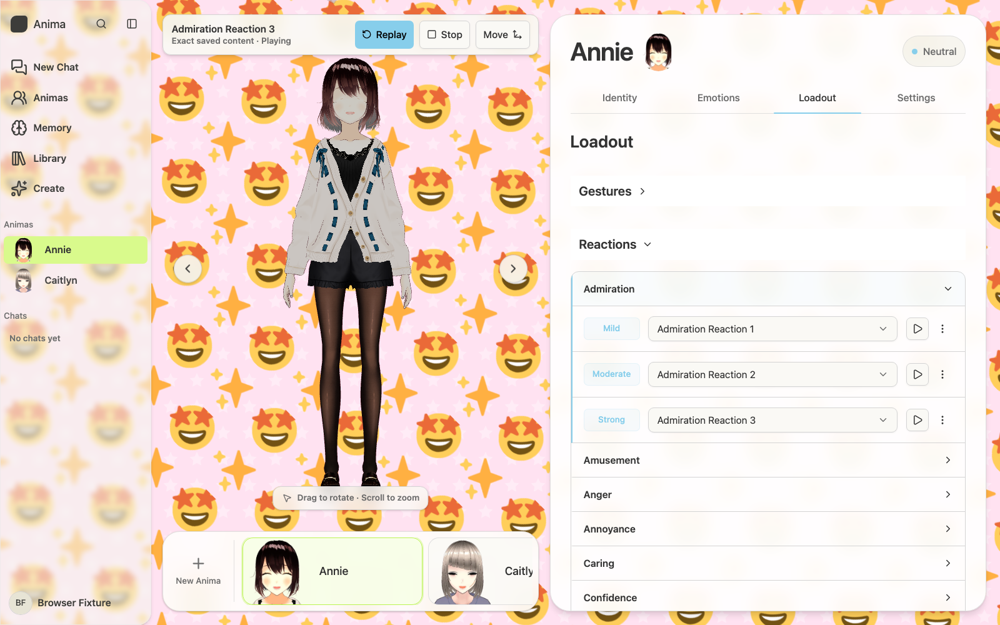
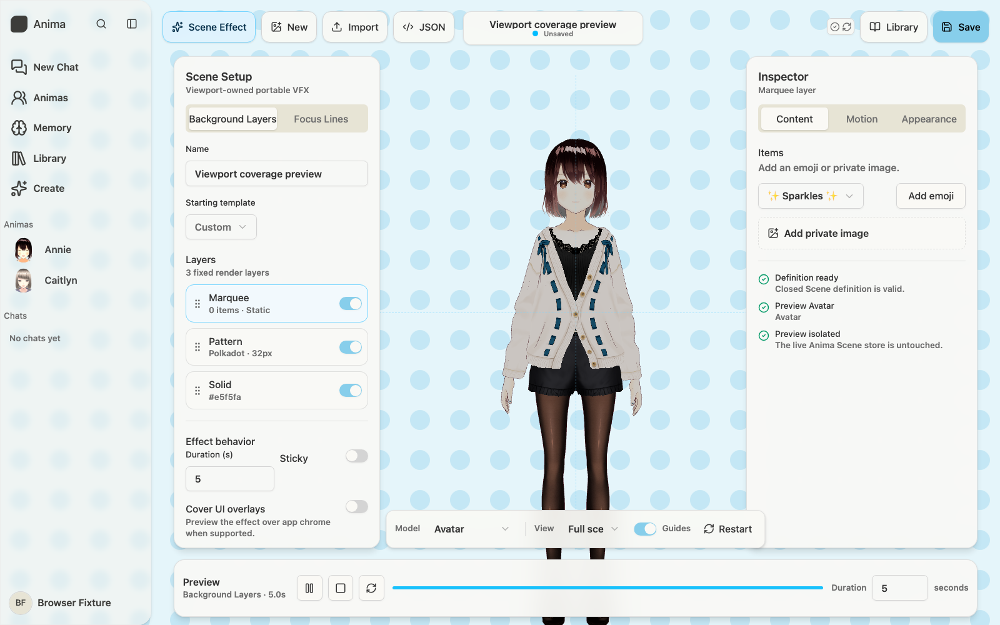

# Full-width scene background verification

Captured 2026-09-20 for issue #23 in Chromium against the task's development
build, using a fresh isolated installation and the synthetic display name
“Browser Fixture”. No personal chats or profile content appear in these images.

At a 1600 × 1000 viewport, both backgrounds occupy `(0, 0, 1600, 1000)`.
The Anima management canvas remains `(242, 0, 638, 1000)`; the Scene Effect
creator canvas remains `(242, 0, 1358, 1000)`. Background rendering does not
resize or reposition either avatar canvas or change camera settings.

The management capture plays the Included Admiration Reaction 3 on the Included
Annie avatar. The creator capture previews an unsaved background document with
the same Included avatar. These are rendered browser evidence, not native
packaged-app or audio acceptance.

Artwork remains subject to its existing terms: the Included VRoid models are
documented in [art notices](../../../../licenses/third-party/art-NOTICES.md).
The Admiration background in these captures shows Twemoji artwork, by Twitter
and contributors under [CC BY 4.0](https://creativecommons.org/licenses/by/4.0/).
These screenshots composite that artwork with the application UI; source model
and emoji bytes were not modified.
